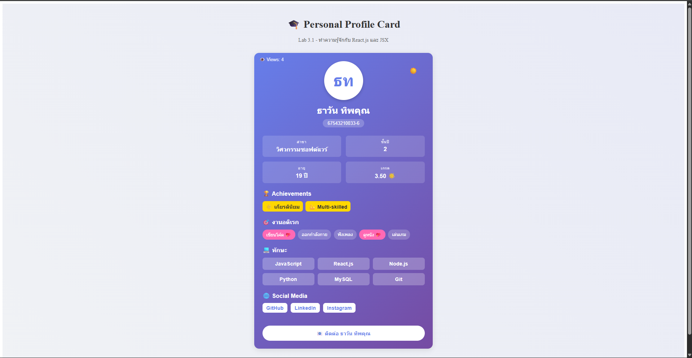
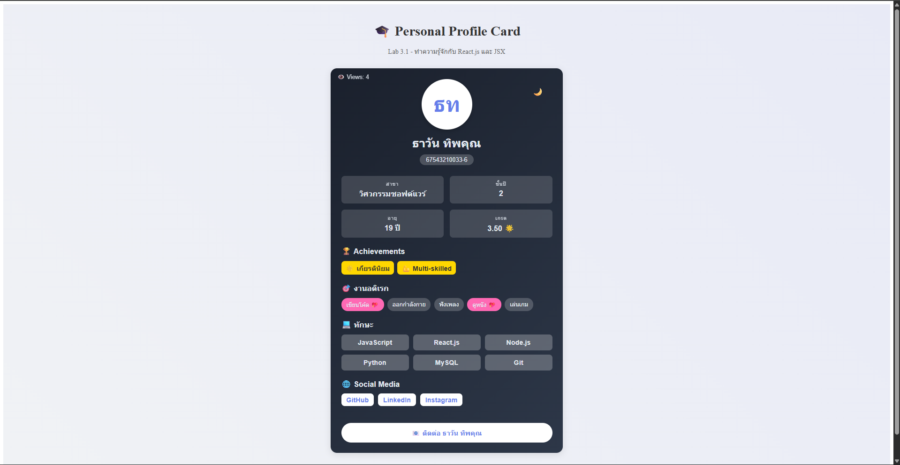

# Interactive Profile Card — React Props & State

**A personal profile card in React: data comes in through props, and interaction is driven by state (dark mode, favourite hobbies, view counter, clickable skills and an inline contact form).**


> **ENGSE203, Lab 3.1: Getting started with React.js and JSX.**

| Light mode | Dark mode |
|---|---|
|  |  |

## Concepts practised

- **Props:** `App` passes a profile object (name, skills, hobbies, social links) into `ProfileCard`
- **State:** `useState` for dark mode, view count, favourite hobbies and contact-form visibility
- **Events:** `onClick` / `onChange` handlers, including clickable skill tags
- **Conditional rendering:** theme switching, achievements and the contact form only appear when relevant
- **Layout:** CSS Flexbox/Grid with a responsive card

## Run

```bash
git clone https://github.com/tawan230666/personal-profile-lab.git
cd personal-profile-lab
npm install
npm run dev
```

---

**Author:** Tawan Tiphkun (ธาวัน ทิพคุณ), 67543210033-6, [@tawan230666](https://github.com/tawan230666), Software Engineering, RMUTL Chiang Mai
